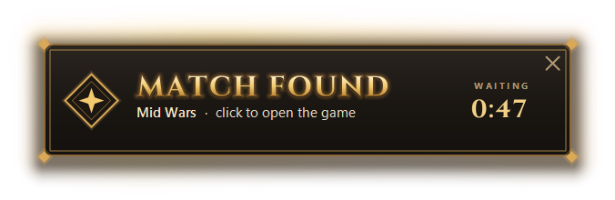
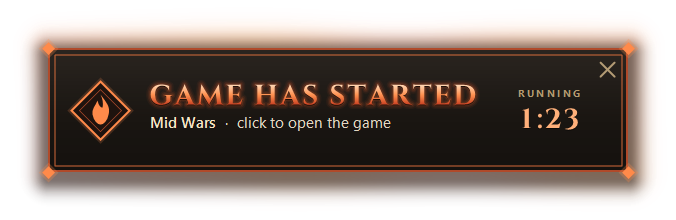
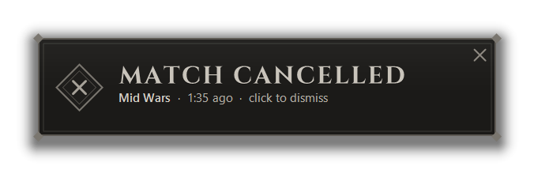
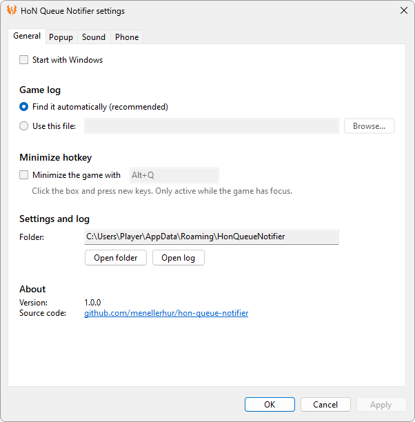
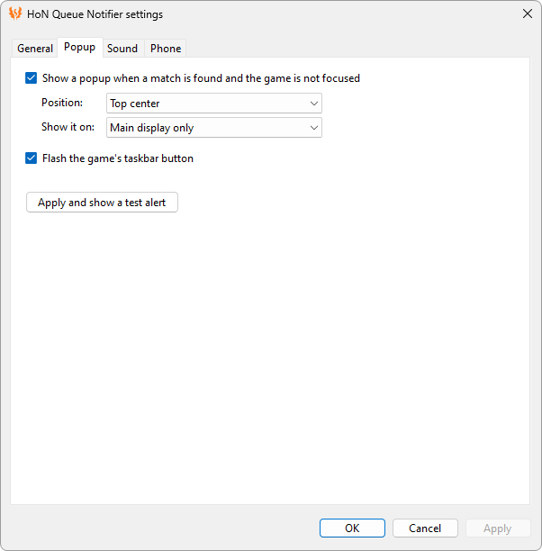
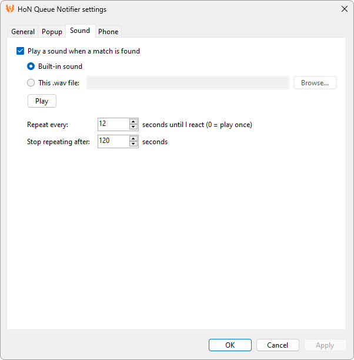
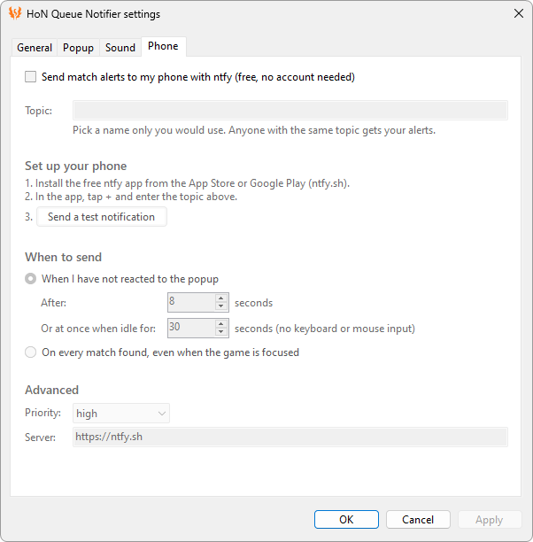

# HoN Queue Notifier

A small Windows tray program for Heroes of Newerth: Reborn. When matchmaking finds you a game while the game window is not focused, it puts a popup on top of whatever you are doing, plays a sound, flashes the game's taskbar button and, if you set it up, pushes a notification to your phone.



Unofficial. Not affiliated with Kongor Studios or Juvio.

## Download

**[Download HonQueueNotifier.exe](../../releases/latest/download/HonQueueNotifier.exe)** (the latest version; all versions are on the [releases page](../../releases)).

Put it in any folder and run it. It needs Windows 10 or 11 and nothing else: no installer, no runtime to download.

The exe is not code-signed (signing costs money), so the first time you run it Windows may say "Windows protected your PC". Click **More info**, then **Run anyway**.

## Use

Start `HonQueueNotifier.exe`. It lives in the tray, near the clock, and works as it is: nothing needs to be set up. Double-click the icon for the settings, or right-click it for:

- **Show a test alert**: what a match alert looks and sounds like. It stays until you click it.
- **Send a test notification to my phone**: enabled once phone notifications are on (see below).
- **Settings...**: the settings dialog.
- **Open this program's log** and **Start with Windows**.

### When a match is found

**If the game is focused**, nothing happens: the game shows the match itself.

**If you are in another window**, you get:

- a popup on your main display
- a repeating sound
- the game's taskbar button flashing

Click the popup to bring the game forward. The popup never goes away on its own: it stays until you click it or switch to the game. While it waits, it keeps up with the match:

- **The game starts**: it turns ember red and says GAME HAS STARTED, without a new sound.
- **The match is cancelled or ends, or you close the game**: it turns into a grey notice, so you see what you missed when you come back.

<p>


</p>

**With phone notifications on**, you also get one push per match: when you have not reacted within 8 seconds, or at once if the PC has been idle for 30 seconds, even with the game focused.

"Focused" means the window you clicked last. The game does not have to be minimised: if another window is in front of it, or you last clicked something on another monitor, you get the alert.

### Settings



<details>
<summary>The four tabs as still images</summary>






</details>

- **General**: start with Windows, where the game log is (found automatically unless you choose a file), an optional key combination that minimizes the game while it has focus (off by default; Alt+Q unless you choose another; useful in fullscreen, where the game cannot be minimized otherwise), the folder with the settings and the log, and the program's version with a link to this repository.
- **Popup**: on or off, position, which display, taskbar flash. "Apply and show a test alert" shows the result at once.
- **Sound**: on or off, the built-in sound or your own `.wav` file (with a Play button), how often it repeats and for how long.
- **Phone**: the ntfy topic, how to set up your phone, when to send, and under Advanced the priority and the ntfy server. See below.

OK and Apply take effect at once; no restart needed. Apply is greyed out until you change something. The dialog checks what you enter and shows any problem in red under the field.

The settings are stored in `HonQueueNotifier.ini` in `%APPDATA%\HonQueueNotifier`, together with the program's own log (`HonQueueNotifier.log`). The General tab shows the folder, with buttons to open it and the log. You never need to touch that file: every setting in it is also in the dialog. You can still edit it by hand: every setting is explained in it, changes are picked up within a few seconds, and comments must be on their own line. The dialog rewrites the file and does not keep comments you added yourself.

### Phone notifications

Phone push uses [ntfy](https://ntfy.sh), which is free: no account and no payment.

1. Install the ntfy app on your phone (iPhone: App Store; Android: Google Play or F-Droid).
2. Open **Settings...**, go to the **Phone** tab, tick "Send match alerts to my phone" and type a topic: a name only you would use, because anyone who uses the same topic gets your alerts.
3. In the ntfy app, tap + and enter the topic.
4. Press **Send a test notification**, then OK.

## How it works

The game client writes `Disconnect - CMatchmakingClient::HandleFoundMatch` to its own `console.log` the moment a match is found, followed by lines for hero pick, game start and the return to the menu. The notifier follows every `console.log` under `Documents\Juvio` and reacts to those lines. Details are in [docs/detection-notes.md](docs/detection-notes.md).

It does not read the game's memory, change the game's files or send the game any input. The only things it does with the game window are ordinary window-manager calls: asking Windows which window is focused, flashing the taskbar button, bringing the window forward when you click the popup, and, if you turn on the hotkey, minimizing it.

If all you want is a beep, this PowerShell one-liner does the detection part with nothing to download (adjust the folder if your log is elsewhere):

```powershell
Get-Content "$env:USERPROFILE\Documents\Juvio\Heroes of Newerth\console.log" -Wait -Tail 0 | Select-String "HandleFoundMatch" | ForEach-Object { [console]::Beep(880,700); "$(Get-Date -Format T)  MATCH FOUND" }
```

## What it does not do

It does not know whether you are in the queue, so there is no queue timer. The log says nothing about joining or leaving the queue, and the notifier deliberately reads nothing but the log ([docs/in-queue-research.md](docs/in-queue-research.md)). It tells you when a match is found, and that is all it is meant to do.

## Command line

| Command | Purpose |
|---|---|
| `HonQueueNotifier.exe` | Run in the tray. |
| `HonQueueNotifier.exe --test` | Run in the tray and show a test alert at once. |
| `HonQueueNotifier.exe --selftest` | Run the built-in checks and write `selftest-result.txt` to `%APPDATA%\HonQueueNotifier`. |
| `start /wait HonQueueNotifier.exe --replay <console.log>` | Show what would have been detected in a saved log. |
| `start /wait HonQueueNotifier.exe --watch` | Console mode: print what is detected, live, without a popup. |

## Build

You need the free [.NET SDK](https://dotnet.microsoft.com/download). Double-click `build.cmd`: it builds `HonQueueNotifier.sln`, puts `HonQueueNotifier.exe` in the repository folder and runs the tests. Or use `dotnet build` and `dotnet test`, or open the solution in Visual Studio.

The program targets .NET Framework 4.8, which is part of Windows 10 and 11, so the finished exe runs without installing anything. The code is in `src/HonQueueNotifier/`, the tests in `tests/`, the popup font, the built-in sound and the icon in `assets/`.

GitHub Actions builds and tests every push. Pushing a tag such as `v1.0.0` (it must match `<Version>` in `HonQueueNotifier.csproj`) also publishes a release with `HonQueueNotifier.exe` attached.

## Credits

The program's icon is adapted from the phoenix emoji by Vanessa Stoessinger for [OpenMoji](https://openmoji.org), the open-source emoji and icon project, licensed under [CC BY-SA 4.0](https://creativecommons.org/licenses/by-sa/4.0/): drawn in one colour, with its outlines cut out and its margin cropped. The icon (`assets/app-icon.svg`, and `assets/app-icon.ico` made from it for the exe file) is under the same licence ([docs/licenses/openmoji-phoenix.txt](docs/licenses/openmoji-phoenix.txt)).

The popup's title font is [Cinzel](https://github.com/NDISCOVER/Cinzel), copyright 2020 The Cinzel Project Authors, used under the SIL Open Font License 1.1 ([docs/licenses/Cinzel-OFL.txt](docs/licenses/Cinzel-OFL.txt)). The program carries a cut-down copy (the bold weight, plain ASCII letters only) inside the exe. Nothing in the program is taken from the game: the popup's look is drawn in code.

The built-in sound is "Successful accepted reward" by tithuh from [Pixabay](https://pixabay.com), used under the Pixabay Content License and shortened for this program ([docs/licenses/match-found-sound.txt](docs/licenses/match-found-sound.txt)). It must not be redistributed on its own.

## Privacy

Nothing leaves your PC unless you turn on phone notifications, in which case a short message ("match found", the map name) goes to the ntfy server you chose (`ntfy.sh` by default). The settings file holds your topic name; do not share it.
